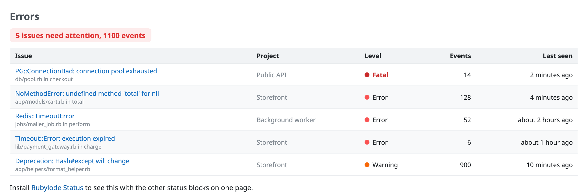
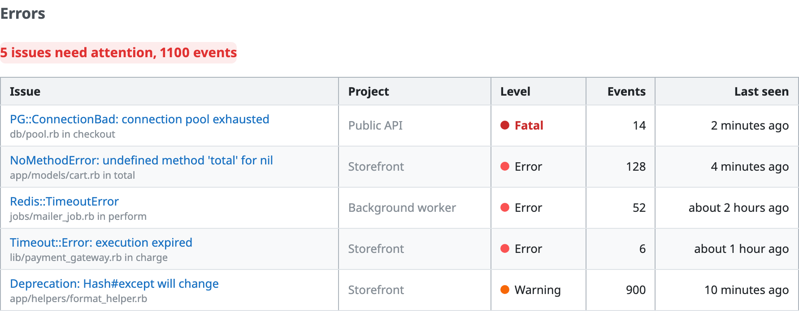
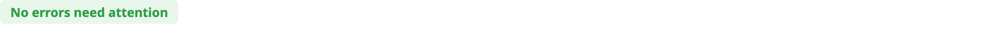
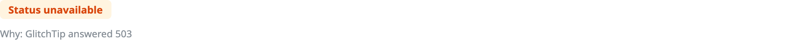
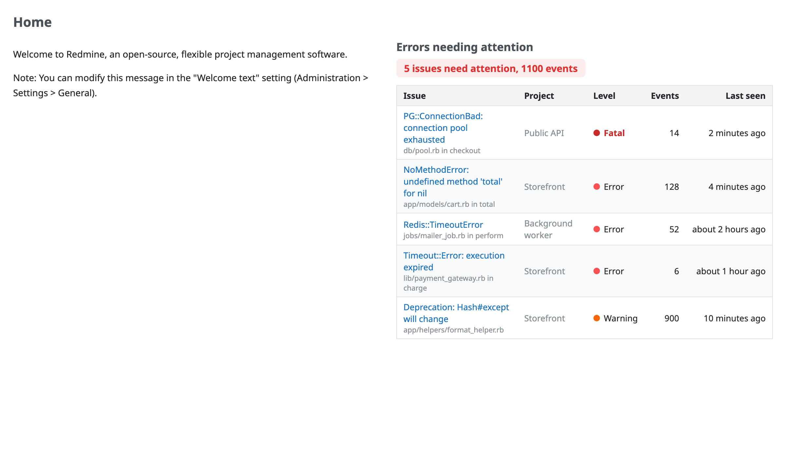
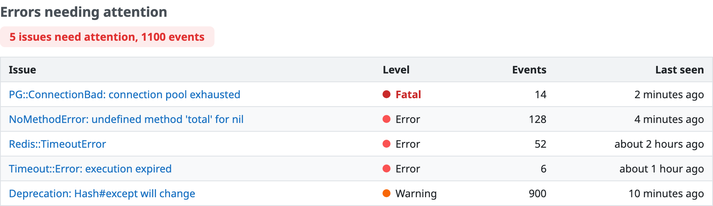
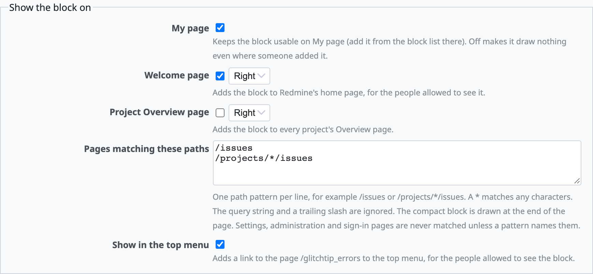
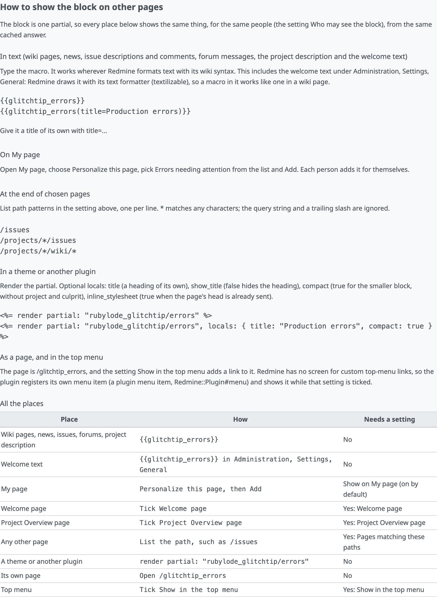

# Rubylode GlitchTip for Redmine

TL;DR: this plugin shows the recent [GlitchTip](https://glitchtip.com) errors that may need attention inside
[Redmine](https://www.redmine.org), as a wiki macro, a page, a My page block and a partial.

Each one is a summary line and a table with the project, level, event count, last seen and a link to the issue in GlitchTip.
The token stays in an environment variable and the block only reads.

Status: version 1.1.1, needs Redmine 5.1 or newer. `docs/roadmap/ROADMAP.md` lists what is decided and what is still open.

Contents:

- [What it does](#what-it-does)
- [What needs attention](#what-needs-attention)
- [How to show the block on other pages](#how-to-show-the-block-on-other-pages)
- [Installation](#installation)
- [Settings](#settings)
- [Security](#security)
- [Theming](#theming)
- [Try it](#try-it)
- [Troubleshooting](#troubleshooting)
- [Tests](#tests)
- [License](#license)

## What it does

A summary line ("No errors need attention", or "3 issues need attention, 214 events") and, under it, a table of the issues:
title and culprit, project, level, event count and when it was last seen. The title links to the issue in GlitchTip.

Ways to show it (the section [How to show the block on other pages](#how-to-show-the-block-on-other-pages) has the details):

- A wiki macro: `{{glitchtip_errors}}`, or `{{glitchtip_errors(title=Production errors)}}`.

  

- A page at `/glitchtip_errors`.
- A My page block called "Errors needing attention" (`rubylode_glitchtip_errors`), added from the My page's block list.
- A partial other plugins and views can render: `render partial: "rubylode_glitchtip/errors"`, with the optional locals
  `title` and `show_title`.

When nothing needs attention the summary says so and there is no table:

When GlitchTip cannot be asked (no answer, a wrong token, a server error) the block says "Status unavailable" and the page
around it still renders. Administrators also see why. Until the address and the organization are set, administrators get a
hint with a link to the settings and everyone else sees nothing.

Everything GlitchTip supplies (titles, culprits, project names) is escaped, so an error whose title contains markup shows as
text. Links are built from the saved address, the organization slug and the issue's numeric id.

## What needs attention

An issue needs attention when all of these hold:

- it is unresolved (resolved and ignored issues never show),
- it was last seen within the look-back window (24 hours by default). A new issue and an old one that came back both
  count, because the window looks at the last time it was seen,
- its level is one of the chosen levels (error and fatal by default),
- its event count is at least the minimum (1 by default). The count is the issue's total, as GlitchTip reports it, not
  the number of events inside the window, and
- it belongs to one of the projects in the allow-list, when there is one.

The issues are ordered by level (fatal, error, warning, info, debug), then by event count (most first), then by last seen
(newest first). Up to "maximum rows" are shown; the summary still counts all of them ("and 4 more issues" is shown under the
table).

The rule is one small class, `RubylodeGlitchtip::AttentionRule`, with its own unit tests.

## How to show the block on other pages

The block is one partial, so every place below shows the same thing, for the same people (the setting "Who may see it"),
from the same cached answer: GlitchTip is asked once for all of them. The same help is on the plugin's settings page.

### In text

Type the macro in a wiki page, a news item, an issue description or comment, a forum message, the project
description, or the welcome text (Administration, Settings, General). The welcome text is drawn with Redmine's text
formatter (`textilizable` in `app/views/welcome/index.html.erb`, checked in Redmine 7.0.2), so a macro in it works like one in
a wiki page.

    {{glitchtip_errors}}
    {{glitchtip_errors(title=Production errors)}}

### On My page

Open My page, Personalize this page, choose "Errors needing attention" in the block list and Add. Each person
adds it for themselves. "My page" in the settings (on by default) turns the block off everywhere on My page when unticked.

### On the welcome page and every project's Overview

Tick "Welcome page" or "Project Overview page" in the settings and
choose the left or the right column. They use Redmine's own hooks (`view_welcome_index_left`/`_right`,
`view_projects_show_left`/`_right`).

### At the end of chosen pages

List path patterns in "Pages matching these paths", one per line, and the compact block (no
project column, no culprit) is drawn after the page's content:

    /issues
    /projects/*/issues
    /projects/*/wiki/*

A `*` matches any characters, slashes included. The query string and a trailing slash are ignored (`/issues` matches
`/issues?set_filter=1` and `/issues/`). Settings, administration, sign-in and account pages never match, not even `/*`,
unless a pattern starts with their own path (`/admin/*`). The block's own page never matches. Only plain page views get it,
not form posts or AJAX requests. The form refuses a pattern that does not start with `/`, has a scheme or host, spaces, or is
longer than 200 characters, and more than 20 patterns.

### In a theme or another plugin

Render the partial. Optional locals: `title` (a heading of its own), `show_title` (`false`
hides the heading), `compact` (`true` for the smaller block), `inline_stylesheet` (`true` when the page's head has been sent
already, so the partial carries its own stylesheet link).

    <%= render partial: "rubylode_glitchtip/errors" %>
    <%= render partial: "rubylode_glitchtip/errors", locals: { title: "Production errors", compact: true } %>

### As a page, and in the top menu

The page is `/glitchtip_errors`. Redmine 7 has no screen for custom top-menu links: a
menu item is registered by a plugin (`menu :top_menu, ...` in `init.rb`, `Redmine::Plugin#menu`). This plugin registers one and
shows it while "Show in the top menu" is ticked and the person may see the block; its caption is the block title.

| Place | How | Needs a setting |
|---|---|---|
| Wiki pages, news, issues, forums, project description | `{{glitchtip_errors}}` | No |
| Welcome text | `{{glitchtip_errors}}` in Administration, Settings, General | No |
| My page | Personalize this page, then Add | "My page" (on by default) |
| Welcome page | Tick "Welcome page" | Yes: Welcome page |
| Project Overview page | Tick "Project Overview page" | Yes: Project Overview page |
| Any other page | List the path, such as `/issues` | Yes: Pages matching these paths |
| A theme or another plugin | `render partial: "rubylode_glitchtip/errors"` | No |
| Its own page | Open `/glitchtip_errors` | No |
| Top menu | Tick "Show in the top menu" | Yes: Show in the top menu |

## Installation

Redmine 5.1 or newer. The folder must be named `redmine_rubylode_glitchtip`, the same as the plugin id.

1. Put the plugin in your Redmine's `plugins` folder:

       cd /path/to/redmine/plugins
       git clone https://github.com/rubylode/redmine-rubylode-glitchtip.git redmine_rubylode_glitchtip

2. Create an API token in GlitchTip (Profile, Auth Tokens) with read access to issues, and put it in an environment
   variable that starts with `GLITCHTIP_`, for example `GLITCHTIP_API_TOKEN`, before Redmine starts.
3. Restart Redmine ([Passenger](https://www.phusionpassenger.com), [Puma](https://puma.io), whatever serves it). There is
   no migration.
4. Open Administration, Plugins, Rubylode GlitchTip, Configure, and set the GlitchTip address and the organization slug.

To remove it, delete the folder and restart. The settings are one row in the settings table.

## Settings

| Setting | Default | Meaning |
|---|---|---|
| GlitchTip address | empty | For example `https://glitchtip.example.com`. |
| Organization slug | empty | The organization's short name in GlitchTip's address. |
| Token environment variable | `GLITCHTIP_API_TOKEN` | The name of the variable holding the token, not the token. Must start with `GLITCHTIP_`. |
| Extra hosts for the token | empty | Optional further host names the token may be sent to. |
| Allow plain http | off | See [Security](#security). |
| Look-back hours | 24 | An issue needs attention when seen within this many hours. |
| Minimum event count | 1 | Issues with fewer events in total are left out. |
| Levels to include | error, fatal | Any of fatal, error, warning, info, debug. |
| Maximum rows | 10 | From 1 to 100. |
| Projects | empty | Optional GlitchTip project slugs; empty means all projects. |
| Cache seconds | 60 | GlitchTip is asked at most once in this many seconds. |
| Failure cache seconds | 30 | After a failed answer GlitchTip is left alone for this long. |
| Timeout seconds | 2 | Connect and read timeout. |
| Block title | Errors needing attention | Heading of the block. |
| Who may see it | everyone signed in | Or administrators only. |
| My page | on | The My page block draws nothing when this is off. |
| Welcome page | off | Show the block on the welcome page, in the left or the right column. |
| Project Overview page | off | Show the block on every project's Overview, left or right. |
| Pages matching these paths | empty | Path patterns, one per line; the compact block goes after the page. |
| Show in the top menu | off | A top-menu link to `/glitchtip_errors`. |

The form checks the values before saving and shows what is wrong; nothing is saved until they are right.

## Security

- The token is never saved. The settings hold only the name of the environment variable. The token is not in the
  database, never rendered in a page (the settings page only says whether the variable is set), never written to the log and
  never part of an error message; anything that would carry it is scrubbed first. Tests check each of these.
- The variable name is restricted to `GLITCHTIP_*`. Without that, whoever may edit the plugin settings could name any
  variable of the server, such as `SECRET_KEY_BASE` or a database password, and have it sent to the address they typed. The
  form refuses other names, and at run time a name outside the prefix is ignored: the token counts as missing and the
  environment is not read.
- The token goes only to the saved host. It is sent to the host of the GlitchTip address (plus the extra hosts, when you
  list any). Redirects are never followed, so a GlitchTip that answers with a redirect to another host does not get the
  token there; the block shows "Status unavailable".
- https is required, except for a loopback host (`localhost`, `127.0.0.1`, `::1`). For GlitchTip on an internal network
  without TLS, tick "Allow plain http"; the token then travels unencrypted, so use it only on a network you trust.
- Everything GlitchTip sends is escaped where it is shown.
- Read access is enough. Give the token the least it needs: reading issues.

## Theming

The block uses plain CSS (`assets/stylesheets/rubylode_glitchtip.css`), and every colour and size is a
`--rubylode-glitchtip-*` custom property set on `.rubylode-glitchtip-errors`. Where Redmine 7 has a colour variable the
default follows it, the dark palette follows the system setting, and a theme that marks its dark mode on the page wins over
that.

| Property | Used for |
|---|---|
| `--rubylode-glitchtip-text`, `-text-muted` | text, and the project, culprit and hints |
| `--rubylode-glitchtip-border` | table borders and row dividers |
| `--rubylode-glitchtip-header-background` | the table header |
| `--rubylode-glitchtip-row-hover-background` | the row under the pointer |
| `--rubylode-glitchtip-clear-color`, `-clear-background` | the "No errors need attention" summary |
| `--rubylode-glitchtip-attention-color`, `-attention-background` | the "N issues need attention" summary |
| `--rubylode-glitchtip-unavailable-color`, `-unavailable-background` | the "Status unavailable" summary |
| `--rubylode-glitchtip-fatal-color`, `-error-color`, `-warning-color`, `-info-color`, `-unknown-color` | the level dot (info also paints debug) |
| `--rubylode-glitchtip-link-color` | links |
| `--rubylode-glitchtip-dot-size`, `-radius`, `-gap` | dot size, corner radius, spacing |
| `--rubylode-glitchtip-summary-font-size`, `-culprit-font-size` | summary and culprit text |

## Try it

A throwaway Redmine 7 runs from this folder, with a fake GlitchTip next to it (`test/support/fake_glitchtip_server.rb`):

    ruby bin/demo up                 start both on http://localhost:3014 and load the demo data
    ruby bin/demo scenario none      switch the fake GlitchTip: several, none, unavailable or hostile
    ruby bin/demo restart            pick up a change to the plugin
    ruby bin/demo reset              wipe it

Sign in as `admin` / `admin`, or as `sam.rivera` / `demo-password-1`. The page is `/glitchtip_errors`, the macro is on the
Storefront project's wiki, and the block is on My page. Everything in the fake GlitchTip is made up.

The screenshots above come from `node script/screenshots.mjs` ([Playwright](https://playwright.dev); the script's header says
how to install it).

## Troubleshooting

If the cache store cannot be read or written (a cache file owned by another user, a full disk), the plugin logs a warning with the error class and message, treats the cache as empty and fetches live. The page still renders.

## Tests

    bin/test                                         all unit and integration tests
    bin/test test/unit/attention_rule_test.rb        one file

They run in a Redmine 7 image with its test gems (`docker/test.Dockerfile`). The rule, the settings, the client and the
report are plain Ruby classes with unit tests; the client is also tested over a real socket against the fake GlitchTip, and
the integration tests cover the page, the macro, the My page block, the settings form and the token's secrecy.

Pull Requests are welcome!

## Releasing

Push a `vX.Y.Z` tag whose version matches `version` in `init.rb` and has an entry in `CHANGELOG.md`. CI runs the tests, builds `redmine_rubylode_glitchtip-X.Y.Z.zip` and publishes the GitHub release with the changelog entry as its notes. To build a release for a tag that already exists, use Actions, release, Run workflow.

The text to paste when listing the plugin on www.redmine.org, and how to read the result of Check for updates, is in [docs/redmine-org-listing.md](docs/redmine-org-listing.md).

## License

GNU General Public License, version 2 or (at your option) any later version, the same as Redmine. See `LICENSE`.

Copyright (C) 2026  Nick Gorbikoff

No warranty, as the GPL says. The plugin sends an API token to the GlitchTip address you configure, so keep the token read-only and try the plugin on a copy of your tracker first. I tested it in CI with the Rubylode plugins' own test suites on Redmine 7.0, 6.1, 6.0 and 5.1, against a fake GlitchTip built from its published API description, not against a running GlitchTip.
